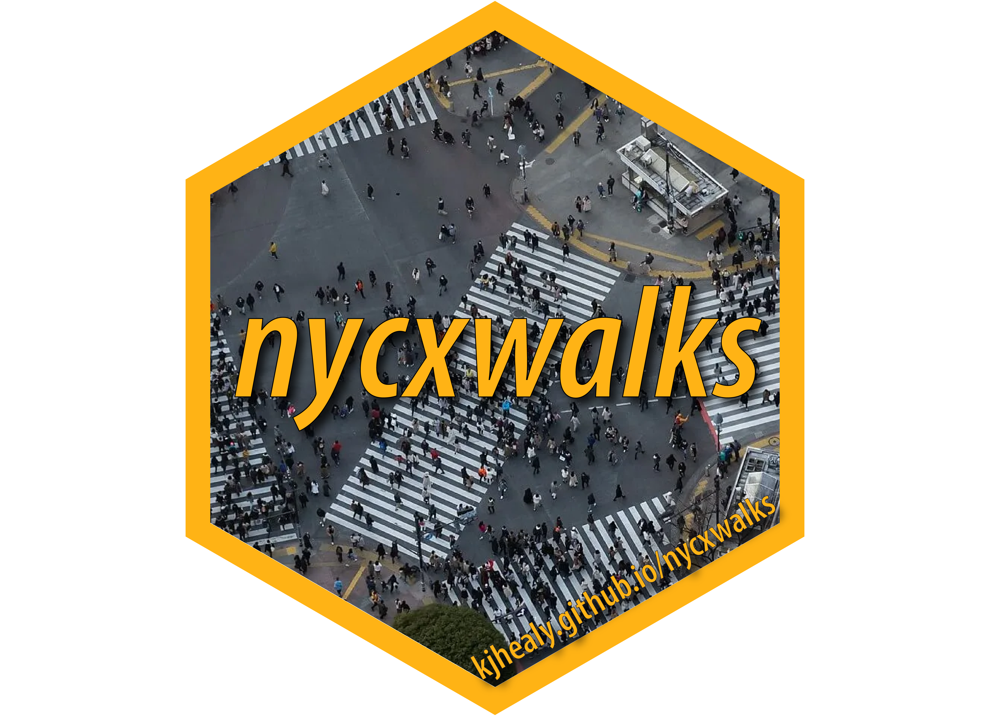

<!-- README.md is generated from README.Rmd. Please edit that file -->

```{r, include = FALSE}
knitr::opts_chunk$set(
  collapse = TRUE,
  comment = "#>",
  fig.path = "man/figures/README-",
  out.width = "100%",
  message = FALSE,
  dpi = 300
)
```

# nycxwalks 

<!-- badges: start -->
<!-- badges: end -->

The nycxwalks package provides crosswalk tables for fifteen New York City geographies. The tables show how the geographies overlap. The geographies are:

- community districts, police precincts, sanitation districts, fire battalions, school districts, and health center districts
- city council, congressional, state assembly, and state senate districts
- business improvement districts, historic districts, and industrial business zones
- Neighborhood Tabulation Areas (NTAs) and Modified ZIP Code Tabulation Areas

For each pair of features that overlap, the tables give the area of the overlap and the share of each feature that the overlap covers. Use these shares to move data from one geography to another. The package also includes the boundaries that nycbuildxwalks used to compute the tables.

[nycbuildxwalks](https://github.com/kjhealy/nycbuildxwalks) built the tables. nycbuildxwalks is an R port of the [Python NYC geography crosswalks tool](https://github.com/MODA-NYC/nyc-geography-crosswalks) by [Nathan Storey](https://github.com/npstorey) at [MODA-NYC](https://github.com/MODA-NYC). That tool builds on the concepts and data aggregation methods of the [BetaNYC NYC Boundaries Map](https://github.com/BetaNYC/nyc-boundaries). The boundaries come from the NYC Department of City Planning, NYC Open Data, and the NYC Economic Development Corporation. nycbuildxwalks downloaded them on 2026-10-24.

## Installation

You can install the development version of nycxwalks from [GitHub](https://github.com/) with:

``` r
# install.packages("pak")
pak::pak("kjhealy/nycxwalks")
```

## Load the package

```{r load}
library(nycxwalks)
library(dplyr)
library(ggplot2)
library(sf)
```

## What's included

```{r geographies}
nyc_xwalk_geographies_df |>
  select(geo_id, geo_name, source, cycle, n_names)
```

The long-format crosswalk has one row for each pair of overlapping features. `pct_overlap` gives the overlap as a share of the primary feature. `pct_of_other` gives the overlap as a share of the other feature.

```{r long}
nyc_xwalk_df
```

The wide-format crosswalk lists, for each feature, the overlapping features in every other geography.

```{r wide}
nyc_xwalk_wide_df
```

`nyc_xwalk_boundaries_sf` has the boundaries, in EPSG:2263.

```{r boundaries}
nyc_xwalk_boundaries_sf
```

## Example: NTAs in a community district

`nyc_xwalk()` returns the crosswalk between two geographies. Here are the Neighborhood Tabulation Areas that make up Brooklyn Community District 6, keeping overlaps of at least 1% of the district.

```{r cd-nta}
nyc_xwalk("cd", "nta", min_pct = 1) |>
  filter(primary_geo_name == "306") |>
  select(other_geo_name, pct_overlap, pct_of_other)
```

## Example: apportioning to another geography

To move a count from one geography to another, divide the count of each source feature among the target features. Use the intersection areas as the weights. Then add the results for each target feature. Because of the 50 ft buffer, the `pct_overlap` values of a feature add up to slightly less than 100. The example below rescales the intersection areas of each source feature to sum to one, so the total count does not change. This method assumes that the count is spread evenly over the area of each source feature. The example moves counts from police precincts to community districts:

```{r apportion}
precinct_counts <- tibble(
  precinct = c("77", "78", "88"),
  n = c(1200, 950, 700)
)

nyc_xwalk("pp", "cd") |>
  inner_join(precinct_counts, by = c("primary_geo_name" = "precinct")) |>
  mutate(
    weight = intersection_area_sqft / sum(intersection_area_sqft),
    .by = primary_geo_name
  ) |>
  summarise(n = sum(n * weight), .by = other_geo_name) |>
  arrange(desc(n))
```

## Example: a map

Brooklyn Community District 6 and the NTAs that overlap it.

```{r map, fig.height = 6}
nta_names <- nyc_xwalk("cd", "nta", min_pct = 1) |>
  filter(primary_geo_name == "306") |>
  pull(other_geo_name)

ntas <- nyc_xwalk_boundaries_sf |>
  filter(geo_id == "nta", geo_name %in% nta_names)

cd6 <- nyc_xwalk_boundaries_sf |>
  filter(geo_id == "cd", geo_name == "306")

ggplot() +
  geom_sf(data = ntas, aes(fill = geo_name), color = "white") +
  geom_sf(data = cd6, fill = NA, color = "black", linewidth = 0.8) +
  labs(
    fill = "NTA",
    title = "Brooklyn Community District 6 and its NTAs"
  ) +
  theme_void()
```

## Methodology

- **Dissolving**: nycbuildxwalks combines features with the same name before it computes overlaps.
- **De-noising**: nycbuildxwalks shrinks each primary feature by 50 feet (a negative buffer) before it intersects the features. It drops overlaps of 100 square feet or less. Thus the two directions of a pair (for example, CD-to-NTA and NTA-to-CD) can differ slightly.
- **Narrow features**: five very narrow features (one BID and four small historic districts) do not survive the buffer. They appear only as other features.
- **ZIP codes** are DOHMH Modified ZIP Code Tabulation Areas (MODZCTAs), not USPS ZIP codes.
- **Areas**: nycbuildxwalks computes areas in EPSG:2263 (NY State Plane, US feet).

## Acknowledgements

The crosswalk method and the dataset definitions come from the [NYC geography crosswalks tool](https://github.com/MODA-NYC/nyc-geography-crosswalks) by [Nathan Storey](https://github.com/npstorey) at [MODA-NYC](https://github.com/MODA-NYC). That tool builds on the concepts and data aggregation methods of the [BetaNYC NYC Boundaries Map repository](https://github.com/BetaNYC/nyc-boundaries). [nycbuildxwalks](https://github.com/kjhealy/nycbuildxwalks) generated the tables. The boundary data come from the [NYC Department of City Planning](https://www.nyc.gov/content/planning/pages/resources), [NYC Open Data](https://opendata.cityofnewyork.us), and the [NYC Economic Development Corporation](https://edc.nyc). `nyc_xwalk_geographies_df` records the source URL and release of each geography.
