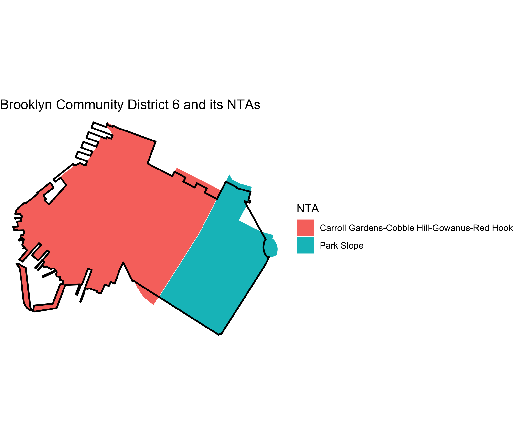

<!-- README.md is generated from README.Rmd. Please edit that file -->

# nycxwalks 

<!-- badges: start -->

[](https://github.com/kjhealy/nycxwalks/actions/workflows/R-CMD-check.yaml)
<!-- badges: end -->

The nycxwalks package provides crosswalk tables for fifteen New York
City geographies. The tables show how the geographies overlap. The
geographies are:

- community districts, police precincts, sanitation districts, fire
  battalions, school districts, and health center districts
- city council, congressional, state assembly, and state senate
  districts
- business improvement districts, historic districts, and industrial
  business zones
- Neighborhood Tabulation Areas (NTAs) and Modified ZIP Code Tabulation
  Areas

For each pair of features that overlap, the tables give the area of the
overlap and the share of each feature that the overlap covers. Use these
shares to move data from one geography to another. The package also
includes the boundaries that nycbuildxwalks used to compute the tables.

[nycbuildxwalks](https://github.com/kjhealy/nycbuildxwalks) built the
tables. nycbuildxwalks is an R port of the [Python NYC geography
crosswalks tool](https://github.com/MODA-NYC/nyc-geography-crosswalks)
by [Nathan Storey](https://github.com/npstorey) at
[MODA-NYC](https://github.com/MODA-NYC). That tool builds on the
concepts and data aggregation methods of the [BetaNYC NYC Boundaries
Map](https://github.com/BetaNYC/nyc-boundaries). The boundaries come
from the NYC Department of City Planning, NYC Open Data, and the NYC
Economic Development Corporation. nycbuildxwalks downloaded them on
2026-10-24.

## Installation

You can install the development version of nycxwalks from
[GitHub](https://github.com/) with:

``` r
# install.packages("pak")
pak::pak("kjhealy/nycxwalks")
```

## Load the package

``` r
library(nycxwalks)
library(dplyr)
library(ggplot2)
library(sf)
```

## What’s included

``` r
nyc_xwalk_geographies_df |>
  select(geo_id, geo_name, source, cycle, n_names)
#> # A tibble: 15 × 5
#>    geo_id     geo_name                           source            cycle n_names
#>    <chr>      <chr>                              <chr>             <chr>   <int>
#>  1 cd         Community Districts                NYC Department o… 25d        71
#>  2 pp         Police Precincts                   NYC Department o… 25d        78
#>  3 dsny       Sanitation Districts               NYC Open Data     <NA>       59
#>  4 fb         Fire Battalions                    NYC Department o… 25d        49
#>  5 sd         School Districts                   NYC Department o… 25d        32
#>  6 hc         Health Center Districts            NYC Department o… 25d        30
#>  7 cc         City Council Districts             NYC Department o… 25d        51
#>  8 nycongress Congressional Districts            NYC Department o… 25d        13
#>  9 sa         State Assembly Districts           NYC Department o… 25d        65
#> 10 ss         State Senate Districts             NYC Department o… 25d        28
#> 11 bid        Business Improvement Districts     NYC Open Data     <NA>       76
#> 12 nta        Neighborhood Tabulation Areas      NYC Department o… 25d       262
#> 13 zipcode    Modified ZIP Code Tabulation Areas NYC Open Data     <NA>      178
#> 14 hd         Historic Districts                 NYC Open Data     <NA>      141
#> 15 ibz        Industrial Business Zones          NYC Economic Dev… <NA>       21
```

The long-format crosswalk has one row for each pair of overlapping
features. `pct_overlap` gives the overlap as a share of the primary
feature. `pct_of_other` gives the overlap as a share of the other
feature.

``` r
nyc_xwalk_df
#> # A tibble: 38,323 × 9
#>    primary_geo_id primary_geo_name other_geo_id other_geo_name primary_area_sqft
#>    <chr>          <chr>            <chr>        <chr>                      <dbl>
#>  1 cd             101              pp           1                      41697017.
#>  2 cd             101              pp           5                      41697017.
#>  3 cd             101              dsny         MN01                   41697017.
#>  4 cd             101              dsny         MN03                   41697017.
#>  5 cd             101              fb           1                      41697017.
#>  6 cd             101              fb           2                      41697017.
#>  7 cd             101              sd           2                      41697017.
#>  8 cd             101              hc           15                     41697017.
#>  9 cd             101              cc           1                      41697017.
#> 10 cd             101              nycongress   10                     41697017.
#> # ℹ 38,313 more rows
#> # ℹ 4 more variables: other_area_sqft <dbl>, intersection_area_sqft <dbl>,
#> #   pct_overlap <dbl>, pct_of_other <dbl>
```

The wide-format crosswalk lists, for each feature, the overlapping
features in every other geography.

``` r
nyc_xwalk_wide_df
#> # A tibble: 1,154 × 17
#>    primary_geo_id primary_geo_name cd    pp        dsny  fb    sd    hc    cc   
#>    <chr>          <chr>            <chr> <chr>     <chr> <chr> <chr> <chr> <chr>
#>  1 cd             101              <NA>  1;5       MN01… 1;2   2     15    1    
#>  2 cd             102              <NA>  1;5;6;9   MN02  2;4;6 2     15    1;2;3
#>  3 cd             103              <NA>  5;7;9     MN03  1;2;… 1;2   14;15 1;2  
#>  4 cd             104              <NA>  10;13;14… MN04  10;7… 2;3   15    3;6  
#>  5 cd             105              <NA>  10;13;14… MN05  6;7;… 2     13;1… 2;3;…
#>  6 cd             106              <NA>  13;17     MN06  4;6;8 2     13;1… 2;4;5
#>  7 cd             107              <NA>  20;24     MN07  11;9  3     15;16 6;7  
#>  8 cd             108              <NA>  114;19;25 MN08  10;45 2     12;13 4;5;8
#>  9 cd             109              <NA>  26;30     MN09  11;1… 3;5;6 16;17 7;9  
#> 10 cd             110              <NA>  28;30;32… MN10  11;1… 3;5;6 11;17 9    
#> # ℹ 1,144 more rows
#> # ℹ 8 more variables: nycongress <chr>, sa <chr>, ss <chr>, bid <chr>,
#> #   nta <chr>, zipcode <chr>, hd <chr>, ibz <chr>
```

`nyc_xwalk_boundaries_sf` has the boundaries, in EPSG:2263.

``` r
nyc_xwalk_boundaries_sf
#> Simple feature collection with 1155 features and 3 fields
#> Geometry type: MULTIPOLYGON
#> Dimension:     XY
#> Bounding box:  xmin: 913175.1 ymin: 120121.9 xmax: 1067383 ymax: 272844.3
#> Projected CRS: NAD83 / New York Long Island (ftUS)
#> First 10 features:
#>    geo_id geo_name geo_name_alt                       geometry
#> 1      cd      101         <NA> MULTIPOLYGON (((979992 1918...
#> 2      cd      102         <NA> MULTIPOLYGON (((981751 2097...
#> 3      cd      103         <NA> MULTIPOLYGON (((987359.7 20...
#> 4      cd      104         <NA> MULTIPOLYGON (((985929.3 22...
#> 5      cd      105         <NA> MULTIPOLYGON (((991725.2 21...
#> 6      cd      106         <NA> MULTIPOLYGON (((994964.3 20...
#> 7      cd      107         <NA> MULTIPOLYGON (((995422.2 23...
#> 8      cd      108         <NA> MULTIPOLYGON (((1000158 219...
#> 9      cd      109         <NA> MULTIPOLYGON (((1000815 241...
#> 10     cd      110         <NA> MULTIPOLYGON (((1002388 243...
```

## Example: NTAs in a community district

`nyc_xwalk()` returns the crosswalk between two geographies. Here are
the Neighborhood Tabulation Areas that make up Brooklyn Community
District 6, keeping overlaps of at least 1% of the district.

``` r
nyc_xwalk("cd", "nta", min_pct = 1) |>
  filter(primary_geo_name == "306") |>
  select(other_geo_name, pct_overlap, pct_of_other)
#> # A tibble: 2 × 3
#>   other_geo_name                               pct_overlap pct_of_other
#>   <chr>                                              <dbl>        <dbl>
#> 1 Carroll Gardens-Cobble Hill-Gowanus-Red Hook        66.1         93.0
#> 2 Park Slope                                          28.0         92.6
```

## Example: apportioning to another geography

To move a count from one geography to another, divide the count of each
source feature among the target features. Use the intersection areas as
the weights. Then add the results for each target feature. Because of
the 50 ft buffer, the `pct_overlap` values of a feature add up to
slightly less than 100. The example below rescales the intersection
areas of each source feature to sum to one, so the total count does not
change. This method assumes that the count is spread evenly over the
area of each source feature. The example moves counts from police
precincts to community districts:

``` r
precinct_counts <- tibble(
  precinct = c("77", "78", "88"),
  n = c(1200, 950, 700)
)

nyc_xwalk("pp", "cd") |>
  inner_join(precinct_counts, by = c("primary_geo_name" = "precinct")) |>
  mutate(
    weight = intersection_area_sqft / sum(intersection_area_sqft),
    .by = primary_geo_name
  ) |>
  summarise(n = sum(n * weight), .by = other_geo_name) |>
  arrange(desc(n))
#> # A tibble: 5 × 2
#>   other_geo_name          n
#>   <chr>               <dbl>
#> 1 308            1241.     
#> 2 302             718.     
#> 3 306             527.     
#> 4 355             364.     
#> 5 307               0.00731
```

## Example: a map

Brooklyn Community District 6 and the NTAs that overlap it.

``` r
nta_names <- nyc_xwalk("cd", "nta", min_pct = 1) |>
  filter(primary_geo_name == "306") |>
  pull(other_geo_name)

ntas <- nyc_xwalk_boundaries_sf |>
  filter(geo_id == "nta", geo_name %in% nta_names)

cd6 <- nyc_xwalk_boundaries_sf |>
  filter(geo_id == "cd", geo_name == "306")

ggplot() +
  geom_sf(data = ntas, aes(fill = geo_name), color = "white") +
  geom_sf(data = cd6, fill = NA, color = "black", linewidth = 0.8) +
  labs(
    fill = "NTA",
    title = "Brooklyn Community District 6 and its NTAs"
  ) +
  theme_void()
```



## Methodology

- **Dissolving**: nycbuildxwalks combines features with the same name
  before it computes overlaps.
- **De-noising**: nycbuildxwalks shrinks each primary feature by 50 feet
  (a negative buffer) before it intersects the features. It drops
  overlaps of 100 square feet or less. Thus the two directions of a pair
  (for example, CD-to-NTA and NTA-to-CD) can differ slightly.
- **Narrow features**: five very narrow features (one BID and four small
  historic districts) do not survive the buffer. They appear only as
  other features.
- **ZIP codes** are DOHMH Modified ZIP Code Tabulation Areas (MODZCTAs),
  not USPS ZIP codes.
- **Areas**: nycbuildxwalks computes areas in EPSG:2263 (NY State Plane,
  US feet).

## Acknowledgements

The crosswalk method and the dataset definitions come from the [NYC
geography crosswalks
tool](https://github.com/MODA-NYC/nyc-geography-crosswalks) by [Nathan
Storey](https://github.com/npstorey) at
[MODA-NYC](https://github.com/MODA-NYC). That tool builds on the
concepts and data aggregation methods of the [BetaNYC NYC Boundaries Map
repository](https://github.com/BetaNYC/nyc-boundaries).
[nycbuildxwalks](https://github.com/kjhealy/nycbuildxwalks) generated
the tables. The boundary data come from the [NYC Department of City
Planning](https://www.nyc.gov/content/planning/pages/resources), [NYC
Open Data](https://opendata.cityofnewyork.us), and the [NYC Economic
Development Corporation](https://edc.nyc). `nyc_xwalk_geographies_df`
records the source URL and release of each geography.
